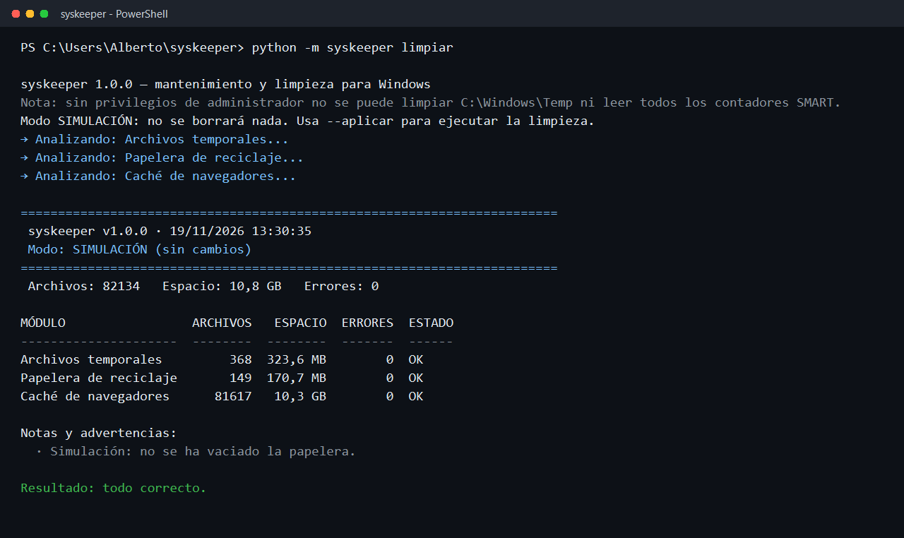

# syskeeper

[](https://github.com/albertourizar/syskeeper/actions/workflows/ci.yml)
[](https://www.python.org/downloads/)
[](LICENSE)
[](CHANGELOG.md)
[](https://www.microsoft.com/windows)

**Automatizador de mantenimiento y limpieza para Windows.** Un solo comando
para liberar espacio (temporales, papelera y cachés de navegadores) y comprobar
la salud real de tus discos mediante SMART, con informes en Markdown y JSON.



> **Seguridad ante todo:** por defecto `syskeeper` **simula** la limpieza y no
> borra nada. Solo elimina archivos cuando se añade `--aplicar`, pide
> confirmación escrita y respeta una lista de rutas protegidas.

---

## Características

- **Limpieza de temporales** del usuario y del sistema (`%TEMP%`,
  `%LOCALAPPDATA%\Temp`, `C:\Windows\Temp` y carpetas propias).
- **Vaciado de la papelera** con medición exacta del espacio recuperado.
- **Cachés de navegadores**: Chrome, Edge, Firefox, Brave y Opera. Nunca toca
  cookies, contraseñas, historial ni marcadores.
- **Salud SMART** vía `Get-PhysicalDisk` y `Get-StorageReliabilityCounter`
  (sin depender del obsoleto `wmic`). Soporte opcional de `smartctl`.
- **Informes** en consola, Markdown y JSON con resumen, errores y espacio libre.
- **Modo desatendido** (`--aplicar --si`) para el Programador de tareas.
- **Códigos de salida** 0/1/2, listos para CI y monitorización.
- **Cero dependencias obligatorias**: solo biblioteca estándar. `psutil` es un
  extra opcional para enriquecer el informe.

## Requisitos

- Windows 10 u 11 (probado en Windows 11 con Python 3.14).
- Python 3.10 o superior.
- PowerShell 5.1 (incluido en Windows).
- Permisos de administrador **solo** para `C:\Windows\Temp`, `Prefetch` y
  algunos contadores SMART. El resto funciona sin elevación.

## Instalación

### Con pipx (recomendado para uso personal)

```powershell
pipx install git+https://github.com/albertourizar/syskeeper.git
```

### Con pip

```powershell
git clone https://github.com/albertourizar/syskeeper.git
cd syskeeper
python -m pip install .
```

### Desde el código fuente (desarrollo)

```powershell
git clone https://github.com/albertourizar/syskeeper.git
cd syskeeper
python -m venv .venv
.\.venv\Scripts\Activate.ps1
python -m pip install -e ".[dev]"
```

## Uso rápido

| Comando | Qué hace |
|---|---|
| `syskeeper limpiar` | Simula la limpieza de temporales, papelera y cachés. |
| `syskeeper limpiar --aplicar` | Limpia de verdad (pide confirmación). |
| `syskeeper smart` | Analiza la salud SMART de los discos. |
| `syskeeper informe` | Mide y guarda un informe sin borrar nada. |
| `syskeeper todo --aplicar --si` | Limpieza + SMART sin preguntas (tareas). |
| `syskeeper config --ejemplo` | Crea un `config.json` editable. |

> **¿Prefieres no usar la terminal?** Haz doble clic en
> `Iniciar syskeeper.bat` (raíz del proyecto) y elige una opción del menú.
> También puedes ejecutar `python iniciar.py` desde una consola.

> Si el comando `syskeeper` no se reconoce, usa `python -m syskeeper` o añade la
> carpeta `Scripts` de tu instalación de Python al `PATH`.

### 1. Ver cuánto se puede liberar (sin borrar)

```powershell
syskeeper limpiar
```

```
syskeeper 1.0.0 — mantenimiento y limpieza para Windows
Modo SIMULACIÓN: no se borrará nada. Usa --aplicar para ejecutar la limpieza.
→ Analizando: Archivos temporales...
→ Analizando: Papelera de reciclaje...
→ Analizando: Caché de navegadores...

========================================================================
 syskeeper v1.0.0 · 19/11/2026 13:25:01
 Modo: SIMULACIÓN (sin cambios)
========================================================================
 Archivos: 1284   Espacio: 1,7 GB   Errores: 0

MÓDULO                ARCHIVOS   ESPACIO  ERRORES  ESTADO
--------------------  --------  --------  -------  ------
Archivos temporales        412   324,0 MB        0  OK
Papelera de reciclaje       31   890,2 MB        0  OK
Caché de navegadores       841   512,4 MB        0  OK

UNIDAD     TOTAL     LIBRE     USO
------  --------  --------  ------
C:\     445,5 GB  104,4 GB  76,6 %
D:\     931,5 GB  214,1 GB  77,0 %

Resultado: todo correcto.
```

### 2. Limpiar de verdad

```powershell
syskeeper limpiar --aplicar
```

El programa muestra los módulos afectados y exige escribir `SI`. Para
automatizar sin interacción, añade `--si`.

### 3. Revisar los discos

```powershell
syskeeper smart
```

```
DISCO                  TIPO  SALUD    DESGASTE  TEMP.  HORAS  ALERTA
---------------------  ----  -------  --------  -----  -----  --------
KINGSTON SA400S37480G  SSD   Healthy         —      —      —  Correcto
WDC WD10JPCX-24UE4T0   HDD   Healthy         —      —      —  Correcto
```

Ejecutado como administrador se rellenan desgaste, temperatura, horas de
encendido y errores de lectura/escritura. Con `--smartctl` se añade el
veredicto de `smartctl` si está instalado.

### 4. Guardar un informe

```powershell
syskeeper informe
```

Se crean `informes/informe_AAAAMMDD_HHMMSS.md` y `.json`. Puedes cambiar la
carpeta con `--config` o desde `config.json`.

## Cómo funciona

| Módulo | Archivo | Alcance |
|---|---|---|
| Temporales | `modules/temporales.py` | `%TEMP%`, `%LOCALAPPDATA%\Temp`, `C:\Windows\Temp`, Prefetch y carpetas extra. |
| Papelera | `modules/papelera.py` | `Clear-RecycleBin -Force` con alternativa COM. |
| Navegadores | `modules/cache_navegadores.py` | Solo `Cache`, `Code Cache`, `GPUCache`, `Cache2`, `startupCache`, `CacheStorage`. |
| SMART | `modules/smart.py` | `Get-PhysicalDisk`, `Get-StorageReliabilityCounter`, `Win32_DiskDrive`, `smartctl` opcional. |
| Informes | `informes.py` | Consola, Markdown y JSON. |
| Seguridad | `utilidades.py` | Rutas protegidas, raíces de unidad, enlaces simbólicos y archivos bloqueados. |

## Seguridad y rutas protegidas

`syskeeper` **nunca** recorre ni borra:

- Raíces de unidades (`C:\`, `D:\`…).
- `C:\Windows`, `System32`, `SysWOW64`, `WinSxS`.
- `Program Files`, `Program Files (x86)` y `ProgramData`.
- `Documents`, `Desktop`, `Downloads`, `Pictures`, `Music`, `Videos`,
  `OneDrive`, `Favorites`, `Saved Games`, `Contacts`, `Links`, `.ssh`.
- `AppData\Roaming\Microsoft`.
- La carpeta `$Recycle.Bin` (se mide y se vacía solo con la API del sistema).
- Enlaces simbólicos, puntos de unión y accesos directos.

Además:

- La antigüedad mínima por defecto es **24 horas** para temporales.
- Los archivos en uso se omiten y se reportan, sin interrumpir la limpieza.
- Los navegadores deben estar cerrados para liberar toda la caché.

> `syskeeper` no se ejecuta como SYSTEM ni eleva privilegios por sí solo. Si lo
> lanzas sin administrador, avisa de las limitaciones en lugar de fallar.

## Configuración

```powershell
syskeeper config --ejemplo
```

| Clave | Tipo | Por defecto | Descripción |
|---|---|---|---|
| `antiguedad_horas` | número | `24` | Horas mínimas antes de borrar un temporal. |
| `antiguedad_cache_horas` | número | `0` | Horas mínimas para la caché de navegadores. |
| `incluir_temporales_sistema` | booleano | `true` | Incluir `C:\Windows\Temp`. |
| `incluir_prefetch` | booleano | `false` | Incluir `Prefetch` (requiere admin). |
| `limpiar_papelera` | booleano | `true` | Activar el vaciado de la papelera. |
| `navegadores` | lista | `chrome, edge, firefox, brave, opera` | Navegadores a limpiar. |
| `directorios_temporales_extra` | lista | `[]` | Carpetas propias a tratar como temporales. |
| `rutas_protegidas_extra` | lista | `[]` | Rutas que nunca se deben tocar. |
| `generar_informe` | booleano | `true` | Guardar informe en disco. |
| `carpeta_informes` | texto | `informes` | Carpeta de salida de los informes. |
| `retencion_informes_dias` | entero | `90` | Días antes de purgar informes antiguos. |
| `incluir_espacio_libre` | booleano | `true` | Añadir el espacio de las unidades. |

La configuración se valida al arrancar: un valor inválido detiene la ejecución
con código 2 en lugar de aplicar una limpieza con parámetros peligrosos.

## Códigos de salida

| Código | Significado |
|---|---|
| `0` | Todo correcto. |
| `1` | Avisos: disco degradado, errores de limpieza o SMART no disponible. |
| `2` | Error de configuración o fallo inesperado. |
| `130` | Cancelado por el usuario (`Ctrl+C`). |

## Automatización

Consulta [`scripts/tarea_programada.md`](scripts/tarea_programada.md) para crear
una tarea diaria a las 03:00 con el Programador de tareas de Windows:

```powershell
schtasks /Create /TN "syskeeper - limpieza diaria" ^
  /TR "\"C:\Ruta\python.exe\" -m syskeeper limpiar --aplicar --si --sin-color" ^
  /SC DAILY /ST 03:00 /RL HIGHEST /F
```

## Documentación

- [Guía de uso detallada](docs/USO.md)
- [Arquitectura y decisiones de diseño](docs/ARQUITECTURA.md)
- [Preguntas frecuentes](docs/PREGUNTAS_FRECUENTES.md)
- [Guía de publicación en GitHub](scripts/publicar.md)
- [Registro de cambios](CHANGELOG.md)

## Desarrollo

```powershell
python -m pip install -e ".[dev]"
python -m ruff check src tests iniciar.py
python -m ruff format --check src tests iniciar.py
python -m mypy src iniciar.py
python -m pytest --cov=syskeeper --cov-report=term-missing
```

La integración continua ejecuta exactamente esos comandos en `windows-latest`
con Python 3.10, 3.12 y 3.14.

Para regenerar la captura del README a partir de una ejecución real:

```powershell
powershell -ExecutionPolicy Bypass -File scripts\generar-captura.ps1
```

## Estructura del proyecto

```
syskeeper/
├─ iniciar.py               # menú interactivo para doble clic
├─ Iniciar syskeeper.bat    # lanzador de Windows
├─ src/syskeeper/           # paquete instalable
│  ├─ cli.py                # subcomandos y códigos de salida
│  ├─ config.py             # configuración validada
│  ├─ informes.py           # consola, Markdown y JSON
│  ├─ limpieza.py           # motor común de borrado seguro
│  ├─ modelos.py            # resultados, discos e informe
│  ├─ registro.py           # log rotativo
│  ├─ utilidades.py         # rutas protegidas y PowerShell
│  └─ modules/              # temporales, papelera, cachés y SMART
├─ tests/                   # 92 pruebas con pytest
├─ docs/                    # guías y capturas
├─ scripts/                 # ejecución y publicación
└─ .github/                 # CI, release y plantillas
```

## Hoja de ruta

- [ ] Limpieza de `WinSxS` con `DISM` bajo confirmación explícita.
- [ ] Análisis de duplicados y archivos grandes.
- [ ] Notificación de escritorio al terminar.
- [ ] Exportación a CSV para inventarios.

Las ideas y errores se gestionan en
[Issues](https://github.com/albertourizar/syskeeper/issues). Lee antes
[CONTRIBUTING.md](CONTRIBUTING.md).

## Licencia

MIT © 2026 [Alberto Urizar](https://github.com/albertourizar). Consulta
[LICENSE](LICENSE).

## Descargo de responsabilidad

Este programa borra archivos de forma permanente cuando se usa con `--aplicar`.
Aunque aplica listas de exclusión y simula por defecto, **revisa siempre el
informe** y mantén copias de seguridad. El autor no se responsabiliza de la
pérdida de datos derivada de un uso incorrecto o de una configuración
modificada a propósito.
